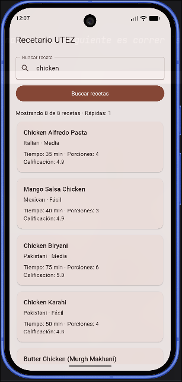
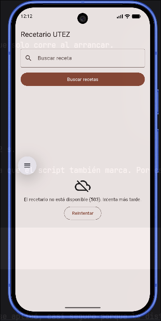
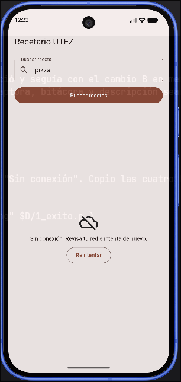
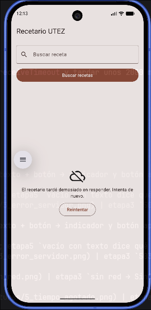

# Evidencias — Recetario UTEZ

**Nombre:** 
**Matrícula:** 20233tn102
**Fecha:** 11 de noviembre de 2026
**Dispositivo donde se probó:** Emulador Android (Pixel_10, Android API 37, x86_64) en Linux

## 1. Del JSON a Dart

| JSON | Campo Dart | Tipo | Regla (obligatorio, tolerado, valor por defecto) |
|---|---|---|---|
| `id` | `id` | `int` | Obligatorio. Si falta o no es `int` → `FormatException` |
| `name` | `nombre` | `String` | Obligatorio. Si falta o no es texto → `FormatException` |
| `cuisine` | `cocina` | `String` | Obligatorio. Si falta o no es texto → `FormatException` |
| `difficulty` | `dificultad` | `Dificultad` | Tolerado. `Easy`/`Medium`/`Hard` → `facil`/`media`/`dificil`; cualquier otro valor, `null` o un número → `desconocida` ("Sin dato"). Nunca lanza error |
| `prepTimeMinutes` | `minutosPreparacion` | `int` | Obligatorio → `FormatException` si falta o no es `int` |
| `cookTimeMinutes` | `minutosCoccion` | `int` | Obligatorio → `FormatException` si falta o no es `int` |
| `servings` | `porciones` | `int` | Obligatorio → `FormatException` si falta o no es `int` (ej. `"4"` como texto) |
| `rating` | `calificacion` | `double` | Obligatorio. Se acepta como `num` (entero `5` o decimal `4.6`) y se guarda con `.toDouble()` |
| `tags` | `etiquetas` | `List<String>` | Opcional. Si falta → `[]`. Si no es lista o algún elemento no es texto → `FormatException` |
| `ingredients` | `ingredientes` | `List<String>` | Opcional. Si falta → `[]`. Si no es lista o algún elemento no es texto → `FormatException` |
| `recipes` | `PaginaRecetas.recetas` | `List<Receta>` | Obligatorio. Cada elemento debe ser objeto; una lista vacía es válida |
| `total` | `PaginaRecetas.total` | `int` | Obligatorio → `FormatException` si falta |
| (`image`, `instructions`, `skip`, `limit`, …) | — | — | Ignorados: la app no los usa |

## 2. Escenarios probados con el servicio real

| Escenario | Cómo lo provoqué | Qué vio la persona | Línea de la bitácora | Captura | Prueba del kit que lo cubre |
|---|---|---|---|---|---|
| Éxito | Busqué `chicken` | Indicador de carga y después el encabezado "Mostrando 8 de 8 recetas · Rápidas: 1" con las tarjetas (Chicken Alfredo Pasta, Mango Salsa Chicken, Chicken Biryani…) | `← 200 GET /recipes/search (292 ms)` |  | etapa3 `200 → PaginaRecetas`; etapa5 `texto + botón → indicador y botón apagado → tarjetas` |
| Vacío | Busqué `zzzz` | El mensaje "No encontramos recetas para "zzzz"." sin botón Reintentar | `← 200 GET /recipes/search (700 ms)` |  | etapa3 `200 sin resultados → página vacía`; etapa5 `vacío con texto dice qué se buscó…` |
| Error del servidor | Cambio temporal A en `main.dart` (ruta `/http/503`) | "El recetario no está disponible (503). Intenta más tarde." con el botón Reintentar | `✗ badResponse 503 GET /http/503 (895 ms)` |  | etapa3 `503 → ErrorDelServidor(503)`; etapa4 `FallaRed → Fallidas con el mensaje de mensajePara` |
| Sin red | Activé el modo avión en el emulador y busqué `pizza` | "Sin conexión. Revisa tu red e intenta de nuevo." con el botón Reintentar | `✗ connectionError GET /recipes/search (36 ms)` |  | etapa3 `sin red → SinConexion`; etapa5 `error → mensaje y Reintentar repite la misma búsqueda` |
| Tiempo agotado | Cambio temporal B: `delay` de 5000 ms y timeouts de 2 s | El indicador de carga unos 2 s y luego "El recetario tardó demasiado en responder. Intenta de nuevo." con el botón Reintentar | `✗ receiveTimeout GET /recipes (2574 ms)` |  | etapa3 `connectTimeout → TiempoAgotado` y `receiveTimeout → TiempoAgotado` |

## 3. Preguntas de reflexión

1. **¿En qué se diferencian "Error del servidor" y "Sin red" desde HTTP?**
   En el error del servidor **sí hubo comunicación HTTP**: la petición llegó y el servidor respondió con un código de estado (503). Dio lo marca como `badResponse` y trae `response.statusCode`. En "sin red" **nunca hubo respuesta HTTP**: no se pudo abrir la conexión (DNS, sin Wi-Fi). No hay código de estado y Dio lo marca como `connectionError`. Por eso uno se traduce a `ErrorDelServidor(503)` y el otro a `SinConexion`, con mensajes distintos: "intenta más tarde" contra "revisa tu red".

2. **¿Por qué "Vacío" no es un error?**
   Porque la petición funcionó: el servidor respondió `200` con `"recipes": []`. La respuesta correcta a "no hay recetas con ese texto" es una lista vacía. Por eso tiene su propio estado (`RecetasVacias`) con un mensaje que dice qué se buscó y no ofrece "Reintentar": repetir la búsqueda daría lo mismo.

3. **La búsqueda viaja en la query. ¿Por qué la bitácora no la escribe?**
   Porque lo que escribe la persona es dato del usuario. En otras apps, en la query también pueden viajar tokens, correos o datos personales. Los logs se copian, se suben a servicios de monitoreo y los leen otras personas. Por eso la bitácora usa `options.path` (solo `/recipes/search`) y no la URL completa: registra lo necesario para depurar (método, ruta, código, tiempo) y nada más.

4. **Si DummyJSON cambiara `rating` por `score`, ¿qué archivos modificarías y por qué solo esos?**
   Solo `lib/datos/recetas_json.dart`, que es el único archivo que conoce los nombres de las llaves del JSON. El resto de la app trabaja con `Receta.calificacion`, que no cambia. El dominio, el ViewModel y las vistas no se tocan, porque las capas están separadas.
